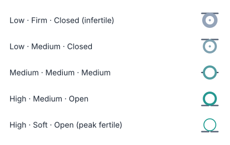
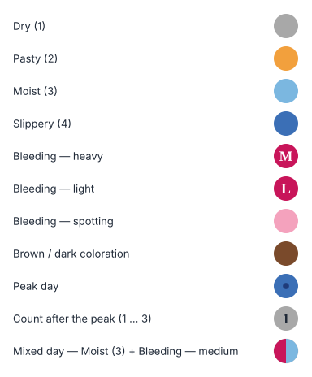
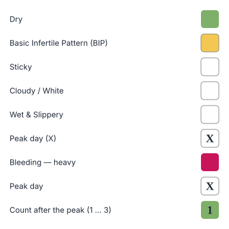
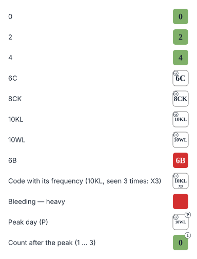
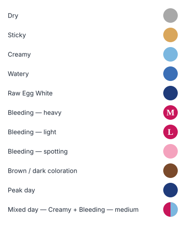

# hds-feminine-cycle-ui

Custom UI for cervical-fluid / cycle-tracking events in the HDS ecosystem — render the same data as **FEMM**, **Billings**, **Creighton**, **Mira**, **Sensiplan**, **sympto-thermal**, **Justisse**, **Chart Neo**, **Marquette** or **Apple Health** style charts, plus a standalone glyph for cervical-position events.

Every display rule comes from the method specification in model-cervical-fluid (`references/rules/method-rules.json`) and ships only when it is sourced; open rules are left out or written as neutral notation. See [`docs/methods/README.md`](./docs/methods/README.md).

Layout-agnostic. The same cell renderer is reused as a timeline marker, a form picker button, a diary-card glyph, or a calendar-grid cell. Hosts position it.

## Install

```bash
npm install hds-feminine-cycle-ui
```

Peer-dep: `react@^19`.

## Quick start

```tsx
import {
  RepresentationCell,
  composeCellInput,
  registry,
  CervixPositionMarker
} from 'hds-feminine-cycle-ui';

// 1. Cycle-fluid cell (FEMM / Billings / Creighton / Mira)
const rep = registry.get('femm');
const input = composeCellInput(eventsForADay, rep);
<RepresentationCell representationId='femm' input={input} size={24} />

// 2. Standalone cervical-position glyph (3-D vector → SHOW glyph)
<CervixPositionMarker height={1.0} firmness={0.5} openness={0.5} size={28} />
```

For force-conversion across methods (e.g. mira-source data displayed under FEMM), pass a `closestOption` callback that wraps the host's converter engine:

```tsx
const closestOption = (methodId: string, vectors: any) => {
  const engine = model.converters.getEngine('cervical-fluid');
  return String(engine.fromVector(methodId, vectors).data ?? '');
};
const input = composeCellInput(events, rep, { closestOption });
```

Peak notation over one cycle (the peak mark and the count after it, as the method writes them):

```tsx
const { peakDay, mark, count } = peakNotation(cycleEvents, rep, { closestOption });
// per day: dayContext = { isPeak: day === peakDay, peakCount: count.find(c => c.day === day)?.n }
const input = composeCellInput(eventsForADay, rep, { closestOption, dayContext });
```

A person's cycles as a paper chart, read-only (Creighton):

```tsx
import { buildCycleChart, CycleChart, registry } from 'hds-feminine-cycle-ui';
import 'hds-feminine-cycle-ui/cycle-chart.css';

const model = buildCycleChart(events, registry.get('creighton'), {
  dayOf: (event) => calendarDayOf(event),   // 'YYYY-MM-DD' in the person's zone, null when the date is not a day
  today: '2026-11-25'
  // rows: [{ startDate: '2026-10-29' }]    // a chart entered from paper records no cycle start
});
<CycleChart model={model} lang='en' />
```

Its text is the host's colour (inherited), light or dark; muted text and lines are drawn from it. A host that draws the
chart on a light card inside a dark page sets `--hdsfc-text` (also `--hdsfc-muted`, `--hdsfc-line`, `--hdsfc-paper`).
It prints as it is seen; for 35 days a line, the page is the host's: `@page { size: A4 landscape; margin: 10mm; }`. Smaller text, or `columns={28}`, for US Letter. A sample: [`docs/cycle-chart.html`](./docs/cycle-chart.html).

A draft of a chart (what was read from paper, not saved) beside what she recorded, to check day by day:

```tsx
const model = buildCycleChart(recordedEvents, registry.get('creighton'), {
  dayOf, today,
  draftRows: [{
    id: 'row-1', startDate: '2026-10-29',         // no startDate: its first day is not answered, its days have no date
    days: [{ day: 1, events: [proposal], state: 'draft', ref: candidateId }]   // 'draft' | 'edited' | 'incomplete' | 'unread'
  }]
});
<CycleChart
  model={model} columns={7}
  onActivateDay={(cycle, day) => show(cycle, day)}  // each day to check is a <button>; "Next to check"; a skip per row
  actionable={(day) => day.draft != null}            // optional: the days that are buttons (default: isDayToCheck)
  toCheck={(day) => !settled.has(day.day)}           // optional: of those, the ones "Next to check" counts (default: actionable)
  selected={shown} rowNote={(cycle) => <RowConfirm cycle={cycle} />}
/>
```

A draft is drawn in a dashed cell, its stamp hatched, with "?" (never as a record); a day written on the chart and not
read is "??", never an empty day; beside a record a draft is "✓" when it says the same, else written under "≠". The chart
writes nothing: the host shows the day (`nextToCheck`, `daysToCheck`) and asks.

## What's in here

- A **registry** of cycle-fluid representations.
- A **pure function** (`composeCellInput`) that reduces N HDS events on a date to a single normalized cell input — supports half-and-half cells when both mucus and bleeding occur on the same day.
- A **peak notation** function (`peakNotation`) — the method's peak day and the 1, 2, 3 count after it, over one cycle's events. Notation only: no fertile / infertile verdict.
- A **peak/fertile detector** (`detectFertilityWindow`) — sliding-window display heuristic over option keys. **Not for patient-facing verdicts**: use `peakNotation` to chart the peak.
- One **React component** (`RepresentationCell`) that draws a cell into a `size × size` SVG box; primitives `dot-circle` (FEMM/Mira) and `stamp-square` (Billings/Creighton) live inside it.
- A second **React component** (`CervixPositionMarker`) that draws a stylised cervix glyph from a 3-D vector — fixed centred ring, horizontal "horizon" bar moves with `height`, ring stroke width with `firmness`, inner-hole radius with `openness`. Standalone (not part of the spec/registry).
- A **cycle chart** (`buildCycleChart`, `<CycleChart>`): a table per cycle, a column per day, what was recorded, and a draft of a chart beside it to check (`draftRows`, `onActivateDay`). Every word can be replaced (`strings`, `localize`, `formatDate`), `renderDay` adds the host's control to a day.
- A shared 7-day fixture (`samplePreviewEvents`) that any registered representation can render previews from.

## Built-in representations

| id          | primitive      | shipped | visual vocabulary |
|-------------|----------------|---------|-------------------|
| `femm`      | `dot-circle`   | v0.1    | [`docs/images/femm-options.svg`](./docs/images/femm-options.svg) |
| `billings`  | `stamp-square` | v0.2    | [`docs/images/billings-options.svg`](./docs/images/billings-options.svg) |
| `creighton` | `stamp-square` | v0.4    | [`docs/images/creighton-options.svg`](./docs/images/creighton-options.svg) · the 95 offered codes: [`docs/images/creighton-codes-grid.svg`](./docs/images/creighton-codes-grid.svg) |
| `mira`      | `dot-circle`   | v0.5    | [`docs/images/mira-options.svg`](./docs/images/mira-options.svg) |
| `sensiplan` | `stamp-square` | v0.9    | [`docs/images/sensiplan-options.svg`](./docs/images/sensiplan-options.svg) |
| `sympto-thermal` | `stamp-square` | v0.9 | [`docs/images/sympto-thermal-options.svg`](./docs/images/sympto-thermal-options.svg) |
| `justisse`  | `stamp-square` | v0.9    | [`docs/images/justisse-options.svg`](./docs/images/justisse-options.svg) |
| `chartneo`  | `stamp-square` | v0.9    | [`docs/images/chartneo-options.svg`](./docs/images/chartneo-options.svg) |
| `marquette` | `stamp-square` | v0.9    | [`docs/images/marquette-options.svg`](./docs/images/marquette-options.svg) |
| `appleHealth` | `stamp-square` | v0.9  | [`docs/images/appleHealth-options.svg`](./docs/images/appleHealth-options.svg) |

Plus the standalone `CervixPositionMarker` glyph for `body-vulva-cervix-position` events (v0.7) — sample glyphs at [`docs/images/cervix-position-samples.svg`](./docs/images/cervix-position-samples.svg):



Three signals encoded in one 28-px glyph (SHOW mnemonic):

- **Height** → horizon-bar y position (Low = top of cell · High = bottom of cell).
- **Firmness** → ring stroke width (Soft = thin · Firm = thick).
- **Openness** → inner-hole radius (Open = large hole · Closed = solid + center dot).

Mean of the three tints the ring slate (infertile) → teal (fertile).

The `*-options.svg` files are auto-generated from the live spec by `npm run docs:images` (see [`scripts/render-method-images.mjs`](./scripts/render-method-images.mjs) and [`AGENTS.md`](./AGENTS.md#regenerating-docsimagesid-optionssvg)). Each shows the full mucus + bleeding + brown/dark + peak-day vocabulary with English labels (and a half-and-half mixed-day cell where the spec opts in). Run `npm run build && npm run docs:images` after editing a spec.

<table>
<tr>
<td align="center">FEMM<br></td>
<td align="center">Billings<br></td>
</tr>
<tr>
<td align="center">Creighton<br></td>
<td align="center">Mira<br></td>
</tr>
</table>

## Documentation

- [`docs/concept.md`](./docs/concept.md) — abstraction model.
- [`docs/methods/README.md`](./docs/methods/README.md) — what each spec ships, from which source, and what is still to confirm.
- [`docs/methods/femm.md`](./docs/methods/femm.md), [`billings.md`](./docs/methods/billings.md), [`creighton.md`](./docs/methods/creighton.md), [`sensiplan.md`](./docs/methods/sensiplan.md), [`sympto-thermal.md`](./docs/methods/sympto-thermal.md), [`justisse.md`](./docs/methods/justisse.md), [`chartneo.md`](./docs/methods/chartneo.md), [`marquette.md`](./docs/methods/marquette.md), [`apple-health.md`](./docs/methods/apple-health.md) — per-method palettes, mapping rules, sources.
- [`AGENTS.md`](./AGENTS.md) — operational notes for AI agents working on this repo.

Reference images live under `docs/images/`; per-method docs link to them.

## Status

`v0.16.0`. See [`CHANGELOG.md`](./CHANGELOG.md).

## License

[BSD-3-Clause](LICENSE)
